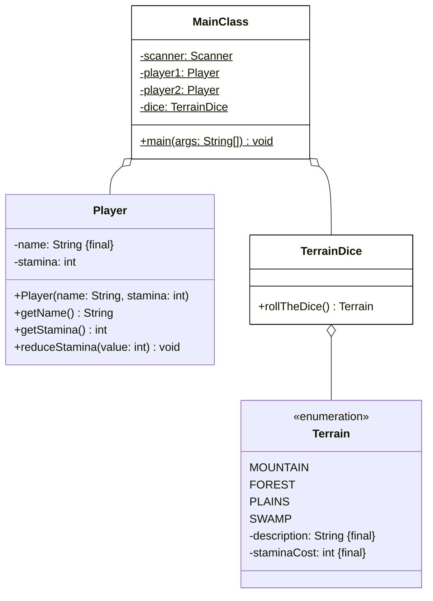

# Aufgabe 2 (25 Punkte)

Erstelle die Klasse **TerrainDice** (5 Punkte) sowie die ausführbare Klasse **MainClass** (20 Punkte) anhand des abgebildeten Klassendiagramms. Die Klassen **Terrain** und **Player** sind bereits vollständig implementiert und müssen nicht erstellt werden. Orientiere Dich bei der Konsolenausgabe am abgebildeten Beispiel.

## Klassendiagramm



## Spielablauf

- Zu Beginn des Spiels sollen die Spieler ihre Namen eingeben können; beide Spieler starten mit einer Ausdauer von **10**
- In jeder Runde soll jeder Spieler einmal mit dem Geländewürfel würfeln; anschließend sollen die Ausdauerkosten des gewürfelten Geländes von der Ausdauer des Spielers abgezogen werden
- Das Spiel soll enden, wenn mindestens ein Spieler keine Ausdauer mehr hat
- Abschließend soll der Gewinner bzw. ein Unentschieden ausgegeben werden

## Beispielhafte Konsolenausgabe

```
Spieler 1, bitte Namen eingeben: Anna
Spieler 2, bitte Namen eingeben: Bob

Runde 1:
Anna würfelt Gebirge (Kosten: 3) - Ausdauer: 7
Bob würfelt Ebene (Kosten: 1) - Ausdauer: 9

Runde 2:
Anna würfelt Sumpf (Kosten: 4) - Ausdauer: 3
Bob würfelt Wald (Kosten: 2) - Ausdauer: 7

Runde 3:
Anna würfelt Gebirge (Kosten: 3) - Ausdauer: 0
Bob würfelt Wald (Kosten: 2) - Ausdauer: 5

Anna hat keine Ausdauer mehr - Bob gewinnt!
```
