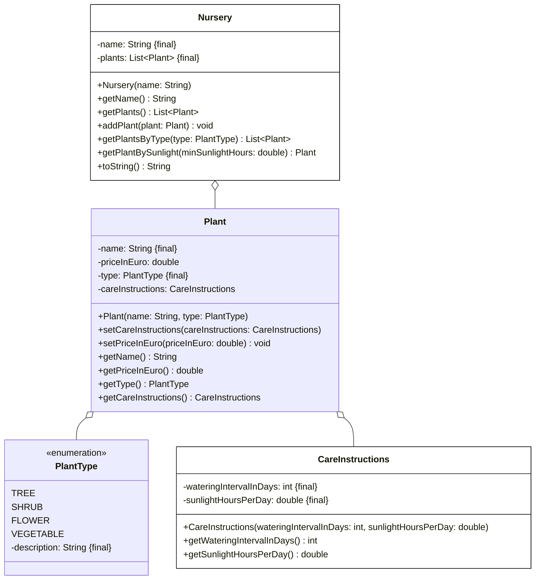

# Aufgabe 3 (30 Punkte)

1. Erstelle die Klassen **CareInstructions** (5 Punkte) und **Nursery** (15,5 Punkte) anhand des abgebildeten Klassendiagramms. Die Klassen **Plant** und **PlantType** sind bereits vollständig implementiert und müssen nicht erstellt werden.

2. Erstelle die ausführbare Klasse **MainClass** (9,5 Punkte) wie folgt: Erstelle die Baumschule **Grüner Daumen** sowie die drei Pflanzen **Apfelbaum** (Baum, Bewässerungsintervall 3 Tage, 6 Sonnenstunden/Tag, 24,90€), **Lavendel** (Strauch, Bewässerungsintervall 5 Tage, 8 Sonnenstunden/Tag, 4,50€) und **Tomate** (Gemüse, Bewässerungsintervall 1 Tag, 7 Sonnenstunden/Tag, 2,99€), füge der Baumschule die 3 Pflanzen hinzu und lasse Dir dynamisch alle Bäume sowie die erste Pflanze mit mindestens 7 Sonnenstunden pro Tag auf der Konsole ausgeben.

## Klassendiagramm

## Hinweise zur Klasse Nursery

- Die Methode **void addPlant(plant: Plant)** soll der Pflanzenliste die eingehende Pflanze hinzufügen (1 Punkt)
- Die Methode **List<Plant> getPlantsByType(type: PlantType)** soll alle Pflanzen vom eingehenden Typ zurückgeben (4 Punkte)
- Die Methode **Plant getPlantBySunlight(minSunlightHours: double)** soll die erste Pflanze zurückgeben, die mindestens die eingehende Anzahl an Sonnenstunden benötigt (4 Punkte)
- Die Methode **String toString()** soll die Baumschule in der Form **[Name], Sortiment: [Pflanzen]** zurückgeben (1,5 Punkte)
