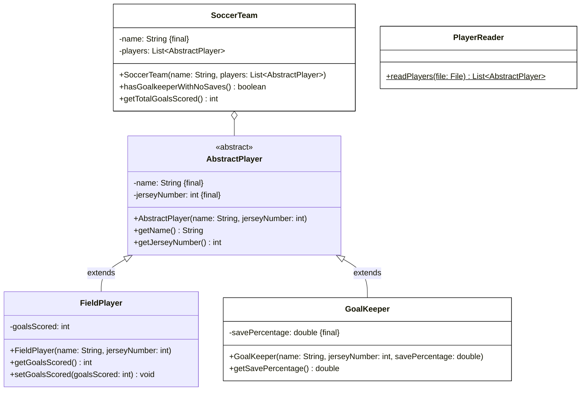

# Aufgabe 4 (28 Punkte)

Erstelle die Klasse **GoalKeeper** (4,5 Punkte), die Klasse **SoccerTeam** (11,5 Punkte) und die Klasse **PlayerReader** (12 Punkte) anhand des abgebildeten Klassendiagramms. Die Klassen **AbstractPlayer** und **FieldPlayer** sind bereits vollständig implementiert und müssen nicht erstellt werden.

## Klassendiagramm



## Hinweise zur Klasse SoccerTeam

- Die Methode **boolean hasGoalkeeperWithNoSaves()** soll zurückgeben, ob das Team einen Torwart mit einer Fangquote von 0% hat (4 Punkte)
- Die Methode **int getTotalGoalsScored()** soll die Gesamtanzahl aller Tore aller Feldspieler zurückgeben (4,5 Punkte)

## Hinweis zur Klasse PlayerReader

Die statische Methode **List<AbstractPlayer> readPlayers(file: File)** soll alle Spieler der eingehenden Datei zurückgeben (11,5 Punkte).

## Beispielhafter Aufbau der Spielerdatei

```
Müller;10;F
Neuer;1;G;92.5
Lewandowski;9;F
```

Jede Zeile enthält **Name**, **Trikotnummer** und **Typ** (`G` für Torwart, `F` für Feldspieler), getrennt durch Semikolons. Bei Torhütern folgt als viertes Feld die **Fangquote**.
